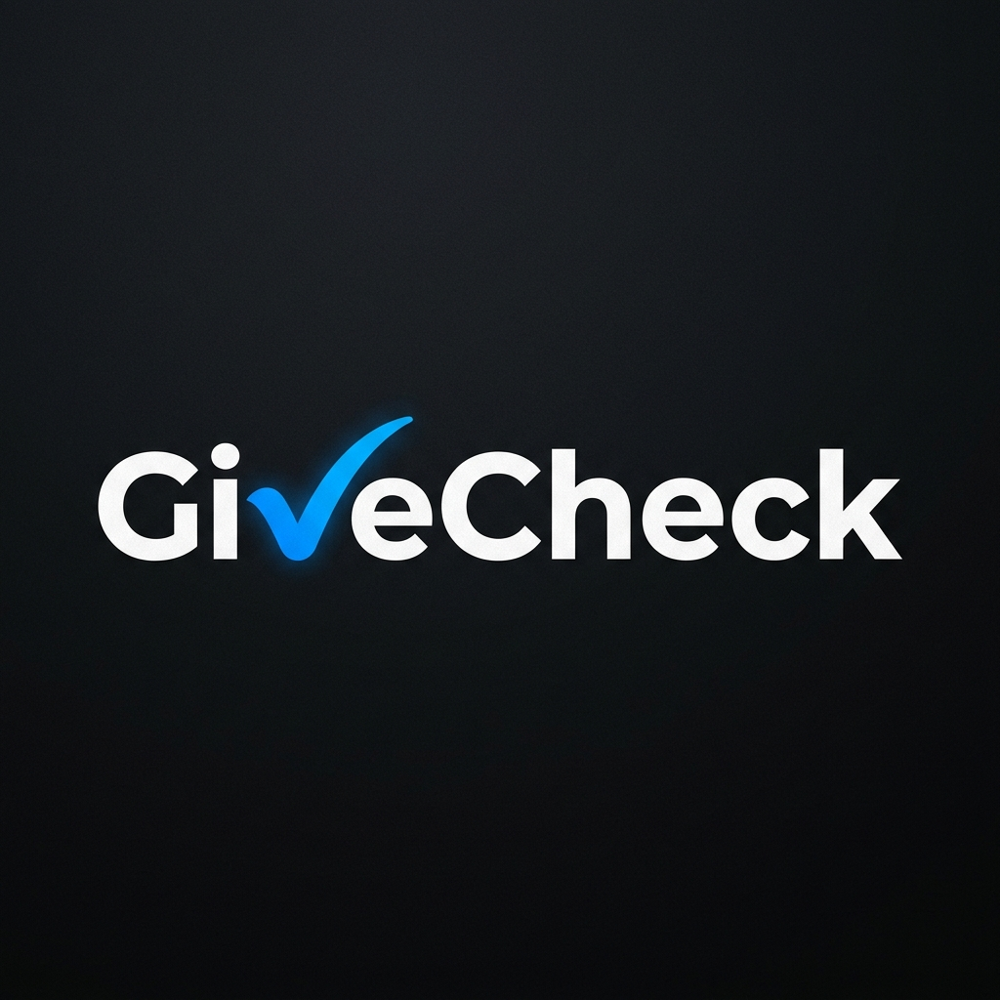
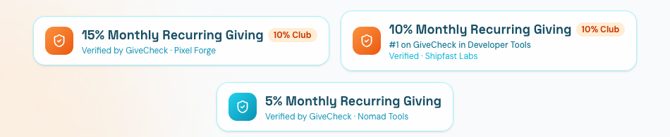

<p align="center">
  
</p>

<h1 align="center">GiveCheck</h1>

<p align="center">
  <strong>Verified Monthly Recurring Giving (MRG) for Startups & Solopreneurs</strong>
</p>

<p align="center">
  
</p>

---

## What Is GiveCheck?

[GiveCheck](https://givecheck.org/) is a verified giving platform for startups and solopreneurs. Think Indie Hackers or TrustMRR for charitable giving, or Product Hunt for generosity.

Companies connect their payment processors (Stripe, Lemon Squeezy, etc.), GiveCheck verifies what % of gross revenue they donate to approved nonprofits, and they earn a public badge and leaderboard ranking. The status game shifts from "who earns the most" to "who gives the most."

## The Insight

Indie Hackers' revenue leaderboard made MRR a status symbol. TrustMRR made verified revenue a trust signal. GiveCheck creates the same dynamic for giving — but verified, public, and competitive.

**The core bet:** Founders will compete to climb a giving leaderboard the same way they compete on revenue leaderboards — if the verification is credible and the social proof is visible.

## The Problem

1. **For founders who want to give:** No systematic, verified way to donate consistently. Giving is ad hoc, untracked, and invisible. Most founders feel guilty about not donating but haven't built the habit.
2. **For consumers and talent:** No way to know which companies actually give back vs. which ones just say they do. Self-reported pledges are cheap.
3. **For the giving ecosystem:** The existing options (1% for the Planet, Pledge 1%, B Corp) are designed for established companies, self-reported, and opaque. Nothing serves the indie hacker / solopreneur market with real verification.

## The Solution

**MRG (Monthly Recurring Giving) — verified by API, displayed on a public leaderboard.**

1. **Connect** — Company connects Stripe (and later other processors) via read-only API
2. **Donate** — Company donates monthly to nonprofits from the curated list or bucket funds
3. **Verify** — GiveCheck cross-references revenue data with donation receipts to calculate verified giving %
4. **Display** — Badge on their website, profile on GiveCheck, position on the leaderboard

## Target Audience

- **Primary:** Solopreneurs and indie hackers making $1K–$50K+/month who feel the tension between building wealth and giving back
- **Secondary:** Small startups and agencies (2-20 people) who want consumer/talent trust signals
- **Long-term:** Mid-market and larger companies seeking a credible, modern alternative to legacy giving pledges

## Benefits for Founders, Consumers, Nonprofits, and the GiveCheck Ecosystem

### 1. For Founders & Startups
* **Competitive Differentiation:** Small companies giving 10% can outrank and outcompete larger incumbents on values.
* **Status & Social Proof:** Turn generosity into a visible trust signal via public leaderboards and badges.
* **Frictionless Habit:** Replaces ad-hoc giving and guilt with automated, API-driven monthly recurring giving (MRG).

### 2. For Consumers & Talent
* **Zero Impact-Washing:** Proof over pledges — consumers know every dollar claimed is verified by Stripe and Every.org.
* **Values-Aligned Purchasing:** Buyers can deliberately choose products that fund vetted causes.
* **Talent Magnet:** Mission-driven builders and employees are proud to work with generous companies.

### 3. For Nonprofits
* **Predictable Recurring Revenue:** Shifts donations from sporadic annual drives to predictable monthly streams.
* **High-Intent Exposure:** Direct distribution to tech founders and startups through curated lists and bucket funds.

### 4. For the GiveCheck Ecosystem (Flywheel & Network Effects)
* **Viral Badge Loops:** Dynamic embed badges on company footers drive continuous inbound traffic to GiveCheck.
* **Cross-Pollination:** Connects a mesh network of generous founders, companies, and nonprofits under a unified standard.

## Comparables & Differentiation

| Platform | Model | Verification | Audience | GiveCheck Advantage |
|---|---|---|---|---|
| 1% for the Planet | 1% of sales, annual dues | Self-reported | Established companies | 10x ambition (10%), API-verified, indie-focused |
| Pledge 1% | 1% equity/time/profit | Honor system | Startups | Verified (not honor system), giving-specific |
| TrustMRR | Verified revenue | Stripe API | SaaS founders | Same verification model, applied to giving |
| B Corp | Comprehensive certification | Expensive audit ($500-$50K/yr) | Mid-market+ | Lightweight, affordable, giving-focused |
| Giving What We Can | 10% income pledge | Self-tracked | Individuals | Companies (not individuals), API-verified |

## Badge System

The GiveCheck badge is fundamentally a **Dynamic JS Embed Widget** snippet pasted into the founder's site, ensuring it evaluates in real-time even on static sites.

### Enforcement & Legal
Because the widget dynamically evaluates GiveCheck's API on page load, if a company churns or misses their giving target, the widget instantly turns gray and displays "Unverified." 
*To counter bad actors who screenshot the badge:* GiveCheck's Terms of Service strictly forbid the use of static GiveCheck imagery. Violators will receive automated Cease & Desist notices protecting the brand's trademark.

Two tiers:

### "X% MRG Verified by GiveCheck"
- Generic badge for any verified giving percentage
- Shows exact %, links to public profile
- Available to all verified members

### The 10% Club
- Premium badge for companies donating 10%+ of gross revenue
- Distinctive visual treatment, premium leaderboard positioning
- Extra benefits (TBD — featured profiles, community access, etc.)

### Badge Variants

There are two distinct badge contexts with different display rules:

**On-site variant** (used on givecheck.org examples, embeddable badges on company websites):
- Always spells out "X% Monthly Recurring Giving" — never uses the abbreviation "MRG" since cold visitors don't know the term
- Embeddable badges additionally show competitive ranking: "#{rank} on GiveCheck in {Category}"
- This Product Hunt-style ranking creates status incentive for founders to embed the badge on their sites

**Short-form variant** (dashboard, profile pages):
- Uses "X% MRG" since users on authenticated pages already understand the term
- No ranking line (the leaderboard table provides that context)

### Visual Badge Previews

<p align="center">
  
</p>


### MRG Education Strategy

MRG (Monthly Recurring Giving) is a new term GiveCheck is coining. To educate visitors:
- The homepage hero includes a bridge headline: "From MRR to MRG — Monthly Recurring Giving — verified, public, competitive."
- This leverages the familiar MRR (Monthly Recurring Revenue) concept that every founder already knows
- All badges visible to cold visitors spell out "Monthly Recurring Giving" — the abbreviation is only used in authenticated contexts

## Leaderboard

The leaderboard is the core product. Rankings execute dynamically based on the verified MRG data:

1. **% of Revenue** (Primary Sort) — the great equalizer. A bootstrapper giving 15% of $5K/mo outranks a funded startup giving 2% of $200K/mo.
2. **Absolute Dollars Given** (Tie-breaker) — Since many founders pledge round numbers (e.g., exactly 10%), ties in percentage are broken by the *total absolute dollars* given currently.
3. **Absolute Dollars View** (Alternate Leaderboard) — A completely separate toggle sorting purely by volume, with optional anonymization for privacy.

### Leaderboard Preview

```text
┌──────┬─────────────────────┬──────────────┬──────────────┬──────────────────┬──────────────┐
│ Rank │ Company             │ Verified MRG │ Given / mo   │ Category         │ Status       │
├──────┼─────────────────────┼──────────────┼──────────────┼──────────────────┼──────────────┤
│  #1  │ 🚀 Pixel Forge      │ 15.0%        │ $3,750 / mo  │ Design Tools     │ 🏆 10% Club  │
│  #2  │ ⚡ ShipFast Labs    │ 12.0%        │ $1,800 / mo  │ Developer Tools  │ 🏆 10% Club  │
│  #3  │ 📊 Indie Analytics  │ 10.0%        │ $1,000 / mo  │ SaaS             │ 🏆 10% Club  │
│  #4  │ 🌿 GreenLeaf Cloud  │ 7.5%         │ $600 / mo    │ Green Tech       │ 🛡️ Verified  │
│  #5  │ 🤖 PromptStack      │ 5.0%         │ $250 / mo    │ AI               │ 🛡️ Verified  │
└──────┴─────────────────────┴──────────────┴──────────────┴──────────────────┴──────────────┘
```

### Categories

The leaderboard supports two filter dimensions, switchable via tab toggle:

**By Industry (32 categories):**
Artificial Intelligence, SaaS, Developer Tools, Fintech, Marketing, E-commerce, Productivity, Design Tools, No-Code, Analytics, Education, Health & Fitness, Community, Content Creation, Crypto & Web3, Customer Support, Entertainment, Games, Green Tech, Information Products, IoT & Hardware, Legal, Marketplace, Mobile Apps, News & Magazines, Real Estate, Recruiting & HR, Sales, Security, Social Media, Travel, Utilities

**By Giving Tier:**
- 10% Club (10%+)
- 5%+ Givers (5%+)
- Rising Stars (1–4.99%)
- All

## Where Donations Go (100% On-Platform)

To ensure flawless verification and scalable revenue, **all donations flow through GiveCheck's platform via the Every.org API** (which has over 1.2M registered 501(c)(3) nonprofits auto-indexed).

There are no manual receipt uploads. Off-platform donations are not evaluated. If a founder's favorite non-profit isn't already on Every.org, the founder is provided a self-serve link to invite them to the API network.

### Option 1: GiveCheck Curated Nonprofit List
Kyle vets and highlights specific nonprofits on the platform.

### Option 2: Bucket Funds
Pooled thematic funds (e.g., HtC Commons Fund, Open Source Fund, Climate Fund). Easy default for founders who don't want to research.

### Option 3: Search the API
Founders can search the 1.2M Every.org database directly through GiveCheck to automate giving to their local or personal favorite charities.

## Revenue Model

### 1. Monthly SaaS Verification Fee (Algorithmic)
Because the platform evaluates Monthly Recurring Giving (MRG), the verification fee operates as a Monthly SaaS Subscription. This lowers the barrier to entry and allows for real-time badge enforcement. 

**Formula:** 0.29% of Verified Monthly MRR (Billed Monthly) — **Capped at $29/mo**.
*On the landing page, this is presented as an interactive slider.*

**Examples:**
- **< $1K/mo:** Free
- **$5K/mo:** $14.50/mo
- **$10K/mo to $50K/mo:** $29/mo (Capped)
- **$50K+/mo:** Custom Enterprise Pricing. Auditing companies at this scale requires resolving multiple payment gateways, wire transfers, and complex enterprise accounting, so verification requires a customized annual contract.

### 2. Sponsored Nonprofit Placements
Nonprofits can pay for sponsored placement within GiveCheck's curated lists and dashboard search results to get in front of generous companies. Pricing will scale directly with GiveCheck's active userbase and total processed volume.

### 3. Future Monetization Opportunities
- **Facilitating Company Acquisitions** - allow companies to list their startup for others to buy.
- **Premium Analytics:** Helping founders track their giving ROI (traffic generated from badge impressions, talent acquisition stats).
- **B2B Matchmaking:** Connect enterprise CSR (Corporate Social Responsibility) programs with top verified giving startups.

## Verification — Technical Details

### Income Verification
API-based, not self-report. Priority by likely market share:

1. **Stripe Connect** (read-only) — covers ~80%+ of target market (solopreneurs, SaaS)
2. **Lemon Squeezy / Gumroad** — common in indie hacker space.
3. **PayPal / Shopify** — for product businesses
4. **Plaid / bank-level** — fallback for edge cases (processor-agnostic, verifies at the bank)

### Donation Verification
- **100% On-platform donations** (curated list / bucket funds / custom search via Every.org API) — auto-verified natively. GiveCheck operates as a software router, verifying the Stripe charge before passing it to the API.

### Revenue Definition
**10% of gross revenue from products and services.** Clear, simple, auditable.

What counts:
- ✅ All payment processor income (Stripe, Lemon Squeezy, Gumroad, etc.)
- ✅ One-time product sales + consulting/service revenue
- ❌ Investment rounds / funding
- ❌ Grant revenue

### Edge Cases
- **Subscription Lapse** — If a payment fails or the GiveCheck subscription is canceled, the JS widget automatically grays out with "Unverified."
- **Rolling 30-Day Window** — Verification is anchored to the founder's donation date, not the 1st of the calendar month. A founder who signs up on April 28 is active by May 28 — no waiting a full month for calendar rollover.
- **Net Revenue** — MRG is calculated on net revenue (charges minus refunds) over the rolling 30-day window, giving an accurate picture of actual income.
- **MRR Variability** — Since billing is evaluated on rolling 30-day net revenue, a bad month means a comparably lower required donation and SaaS fee, taking the pressure off bootstrapper cash-flow slumps.
- **International Founders** — US-only charities/tax rules for MVP.
- **Gaming Prevention** — 100% API routing prevents gaming. Founders cannot fake Stripe revenue or Every.org donation receipts because GiveCheck is fundamentally moving the money.

## MVP Scope

Ship first (in order):
1. Landing page with concept + waitlist signup
2. Stripe Connect integration (read-only revenue verification)
3. Every.org API integration (donate to curated list directly via Stripe checkout)
4. Dynamic JS Badge widget for verified companies
5. Public leaderboard (% primary, $ secondary with anonymization) with options for categories (htc, open source, climate, etc.)
6. Automated Monthly Sync & Enforcement Script

Skip for v1: community voting, investment fund, multi-processor automation, non-US currency, manual verification workflow (DEPRECATED), Referral Program
